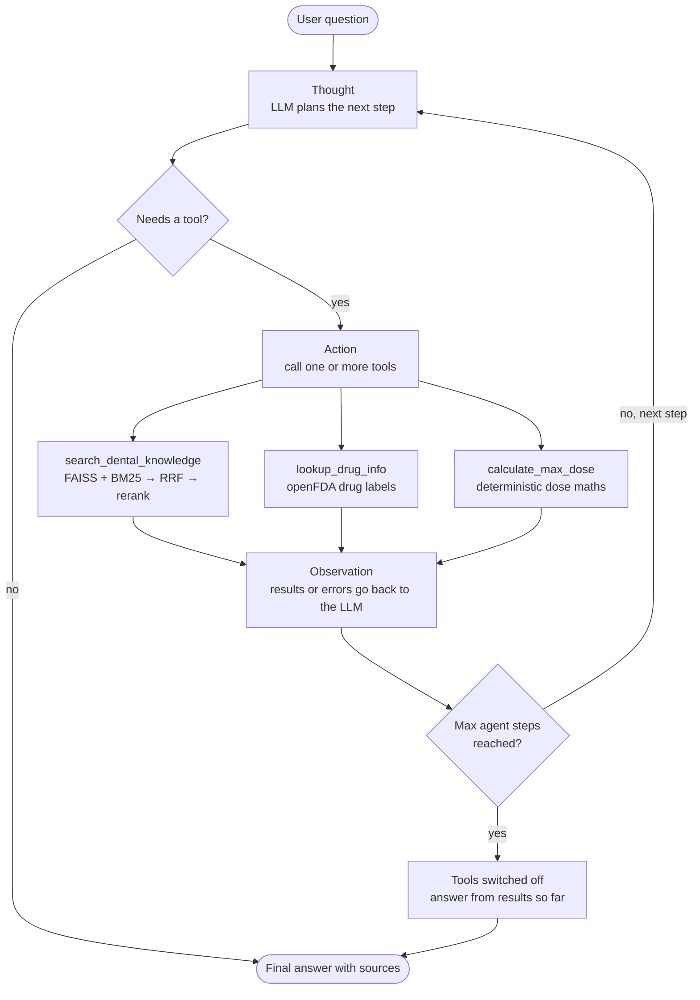

# MedMCQA RAG Chatbot → Dental Clinic Agent

This project contains a RAG chatbot over MedMCQA and California Dental Association documents, and a
**tool-calling LLM agent** built on top of it. The agent plans, picks tools with **OpenAI function
calling**, reads the results and repeats (ReAct style) until it can answer. The RAG pipeline is one
of its tools.

## Dental Agent

### How the agent works (ReAct loop)

Each step is **Thought → Action → Observation**: the LLM plans, calls tools, reads their results,
and repeats until it can answer.



### Tools

| Tool | What it does | Why it is a tool |
|---|---|---|
| `search_dental_knowledge` | Hybrid FAISS + BM25 retrieval with RRF and cross-encoder reranking (the RAG pipeline) | Grounds answers in the knowledge base |
| `lookup_drug_info` | Official FDA drug labels from the public openFDA API | Live external data the model cannot know |
| `calculate_max_dose` | Maximum local anaesthetic dose in mg and cartridges | LLMs are unreliable at arithmetic; this is deterministic |

### Code

```text
agent/
|-- loop.py            # the function-calling loop (no framework): plan -> act -> observe -> answer
|-- prompts.py         # system prompt
|-- tools/
|   |-- base.py        # Tool + ToolRegistry: Python function -> OpenAI tool schema; errors go back to the model
|   |-- knowledge.py   # wraps src/retrieval.py (same FAISS index, same rerank threshold)
|   |-- drug_info.py   # openFDA client
|   `-- dosing.py      # dose calculator
|-- __main__.py        # CLI: uv run python -m agent "question"
`-- app.py             # Streamlit chat UI showing tools used and the agent trace
tests/                 # 27 offline tests (fake model client, fake retrieval, mocked HTTP)
```

### Run it

With `OPENAI_API_KEY` in `.env`:

```powershell
uv sync
uv run pytest
```

Ask one question from the terminal:

```powershell
uv run python -m agent "Max lidocaine 2% dose for a 60 kg patient, in cartridges?"
```

Launch the agent UI:

```powershell
uv run streamlit run agent/app.py
```

Always start Streamlit with `uv run`. A plain `streamlit run` may pick up a global Python
installation that does not have `faiss` and fails with `Could not import faiss python package`.

`search_dental_knowledge` needs the FAISS index from the RAG setup below (steps 5–6). Without it,
the tool returns an error, and the agent keeps working with the other two tools.

Set `AGENT_MODEL` to change the model. To try a local model, point the OpenAI client at Ollama's
OpenAI-compatible API: `OPENAI_BASE_URL=http://localhost:11434/v1`, `OPENAI_API_KEY=ollama`,
`AGENT_MODEL=qwen2.5:7b` (use a model that supports tool calling).

> The dose reference values in `agent/tools/dosing.py` are commonly cited dental maximums.
> Educational use only, not medical advice.

### Agent UI

For each answer, `agent/app.py` shows:

- **Tools used**: the tools the agent called, in order, e.g.
  `search_dental_knowledge → lookup_drug_info`.
- **Agent trace** (the "Done · N tool calls" panel): the agent's plan, then every tool call with
  its arguments, run time and result.

### Max agent steps

**Max agent steps** (sidebar, default 6) caps how many rounds of *call tools → read results* the
agent may do before it must answer. It exists to **prevent infinite loops**: an LLM can keep
searching with slightly different queries and never stop. When the limit is reached, tools are
switched off and the model is told to answer from the results it already has, so the user always
gets an answer.

It is a limit, not a target: a simple question uses one step, and one step can run several tools
at once. The limit also caps cost and waiting time (at most `max_steps + 1` model calls per
question).

### Known limitations

- The agent can only find what is in the knowledge base. For example, nothing in the MedMCQA
  dental rows or the CDA PDFs covers dry socket, so both the RAG and the agent return "not found".
- After a failed search the agent does not retry with a synonym (e.g. *alveolar osteitis*).
- The model sometimes adds facts from memory or overstates a drug label despite the system prompt.

---

# Original RAG pipeline

This project builds a small retrieval-augmented generation (RAG) pipeline over the MedMCQA dataset and a set of dental PDF reference documents. It exports the dataset to CSV, extracts PDFs to Markdown, stores the mixed corpus in FAISS, and exposes retrieval through both a terminal script and a Streamlit chatbot.

## What This Project Does

- Exports `train` and `validation` from `openlifescienceai/medmcqa` into a local CSV.
- Converts each row into a retrievable document using `question` and `exp`.
- Extracts the PDFs in `data/raw/pdf` with MinerU, saves Markdown intermediates, and chunks the extracted text.
- Builds a mixed FAISS vector store with `text-embedding-3-small`.
- Retrieves candidate documents with FAISS and BM25, fuses them with RRF, and reranks the top candidates with a cross-encoder.
- Rejects retrieval if the cross-encoder rerank score is below the configured acceptance threshold.
- Uses `gpt-4o-mini` to rewrite accepted retrieved context into exactly one grounded sentence.
- Provides a RAGAS evaluation script for `Context Precision`, `Context Recall`, `Faithfulness`, and `Answer Relevancy`.

## Tech Stack

- Python `3.12`
- `uv` for environment and dependency management
- Hugging Face `datasets` for dataset loading
- `pandas` for CSV handling
- LangChain for orchestration
- OpenAI embeddings: `text-embedding-3-small`
- OpenAI chat model: `gpt-4o-mini`
- FAISS for vector search
- RAGAS for evaluation
- Streamlit for the chatbot interface

## Project Structure

```text
grp-asgmt/
|-- data/
|   |-- evals/
|   |   |-- qa_eval.csv
|   |   `-- results/
|   |-- processed/
|   |   `-- pdf_markdown/
|   |-- raw/
|   |   `-- medmcqa_data.csv
|   `-- vectorstores/
|       `-- mixed/
|           |-- index.faiss
|           `-- index.pkl
|-- src/
|   |-- datasets_rag.py
|   |-- preprocessing.py
|   |-- retrieval.py
|   `-- interface_new.py
|-- AGENTS.md
|-- pyproject.toml
|-- uv.lock
`-- README.md
```

## Replication Guide

### 1. Prerequisites

- Python `3.12.x`
- `uv` installed
- An OpenAI API key

### 2. Clone the repository

```powershell
git clone <your-repo-url>
cd <your-repo-url>
```

### 3. Sync dependencies

```powershell
uv sync
```

### 4. Create a `.env` file

Create a `.env` file in the project root with:

```env
OPENAI_API_KEY=your_api_key_here
```

### 5. Export the MedMCQA dataset to CSV

```powershell
uv run python src/datasets_rag.py
```

This writes:

```text
data/raw/medmcqa_data.csv
```

The exported CSV keeps only:

- `question`
- `exp`

### 6. Build the FAISS vector store

```powershell
uv run python src/preprocessing.py
```

Data paths in `src/preprocessing.py` are anchored to the repo root, so this script, `retrieval.py`
and the Streamlit interfaces work from any folder. The evaluation scripts (steps 8–9) still use
paths relative to the current folder, so run them from the repo root.

This writes:

```text
data/vectorstores/mixed/index.faiss
data/vectorstores/mixed/index.pkl
```

### 7. Test retrieval from the terminal

```powershell
uv run python src/retrieval.py --source all
```

You will be prompted for a question. The script then:

- loads the saved FAISS index
- retrieves the top 15 FAISS and top 15 BM25 candidates
- supports `--source all`, `--source pdf`, or `--source medmcqa`
- fuses candidates with RRF, keeps the top 20, and reranks them with a cross-encoder
- checks whether the rerank score is at least the configured acceptance threshold
- either rejects retrieval or generates a one-sentence grounded answer

### 8. Run RAGAS evaluation

```powershell
uv run python src/evaluate_ragas.py
```

The evaluator expects `data/evals/qa_eval.csv` with:

- `question`
- `reference`
- `reference_contexts` as a JSON array string
- optional `source_filter`

It uses `gpt-4o` as the RAGAS judge model and writes per-sample traces and metric summaries to `data/evals/results/` in a timestamped folder.

### 9. Tune the rerank acceptance threshold

```powershell
uv run python src/tune_rerank_threshold.py
```

The tuner expects `data/evals/rerank_threshold_eval.csv` with:

- `question`
- `expected_relevant`
- optional `notes`

It runs live retrieval against all sources, saves per-question rerank scores, sweeps candidate thresholds, and writes artifacts to `data/evals/results/`.

### 10. Launch the Streamlit chatbot

```powershell
uv run streamlit run src/interface_new.py
```

The UI:

- keeps chat rooms in the sidebar that you can create, rename and delete
- treats each user question independently
- caches the vector store for faster reuse
- shows the latest retrieval diagnostics in a separate panel

## Example Behavior

### Accepted retrieval

If the top match is sufficiently similar:

- the system accepts the retrieved chunk
- `gpt-4o-mini` rewrites the retrieved explanation into one coherent sentence

### Rejected retrieval

If the top reranked match is below the rerank acceptance threshold:

- no answer is generated from the LLM
- the system explicitly reports that no sufficiently similar context was found

## Codebase Breakdown

### 1. Data export

File: [src/datasets_rag.py](src/datasets_rag.py)

Responsibilities:

- loads `openlifescienceai/medmcqa`
- concatenates `train` and `validation`
- keeps only `question` and `exp`
- saves the result as `data/raw/medmcqa_data.csv`

### 2. Indexing

File: [src/preprocessing.py](src/preprocessing.py)

Responsibilities:

- reads the exported CSV
- converts each row into a LangChain `Document`
- stores `question + exp` together as a single retrieval unit
- builds a FAISS index using `text-embedding-3-small`
- saves the vector store to disk

### 3. Retrieval and generation

File: [src/retrieval.py](src/retrieval.py)

Responsibilities:

- loads the local FAISS vector store
- embeds the user query
- retrieves the top 15 vector and top 15 BM25 candidates
- uses RRF to keep the top 20 fused candidates for cross-encoder reranking
- rejects matches below the rerank acceptance threshold
- uses `gpt-4o-mini` only when retrieval is accepted
- returns the answer, score, retrieved chunk, and metadata

### 4. User interface

File: [src/interface_new.py](src/interface_new.py)

Responsibilities:

- provides a Streamlit chatbot
- depends on the retrieval logic in `retrieval.py`
- shows the conversation in the main panel
- shows the latest retrieval diagnostics in a side panel

## Architecture Overview

The implemented pipeline is:

```text
MedMCQA dataset
    -> CSV export
    -> row-level documents
    -> OpenAI embeddings
    -> FAISS vector store
    -> FAISS top 15 + BM25 top 15 retrieval
    -> RRF top 20 candidate fusion
    -> cross-encoder reranking
    -> rerank acceptance check
    -> grounded one-sentence answer
    -> terminal or Streamlit interface
```

### Retrieval design decisions

- Retrieval unit is one full MedMCQA row, not a chunked fragment.
- Retrieval combines vector and keyword candidates before reranking.
- Generation is grounded only in the retrieved context.
- If retrieval confidence is too low, the system rejects instead of hallucinating.

## Known Limitations

- Reranker acceptance still uses a fixed provisional threshold.
- Answers are restricted to one sentence only.
- The system now works over both the exported MedMCQA CSV and the PDFs in `data/raw/pdf`.
- The evaluation framework still needs curated rows in `data/evals/qa_eval.csv` before it can produce meaningful RAGAS scores.
- The current project structure still relies on script-level imports rather than a fully packaged module layout.

## Future Work

- Add PDF ingestion for medical reference documents.
- Add chunking for long-form sources such as PDFs.
- Tune the rerank acceptance threshold on a validation set instead of using a fixed provisional value.
- Package the `src` directory more cleanly to avoid script-relative import fragility.
- Change to locally hosted models, including `gemma-4` and `multilingual-embeddings`

### Agent

- Port the hand-written loop to **LangGraph**: model the ReAct loop as a graph (plan → call tools →
  observe → answer) with built-in state, checkpointing and conversation memory.
- Rewrite or retry the knowledge-base search with synonyms (e.g. *alveolar osteitis* for dry socket)
  when the first search is rejected.
- Evaluate the agent against the RAG baseline: answer quality, tool-choice accuracy, number of steps,
  latency and cost.

## Notes

- The vector store loader uses `allow_dangerous_deserialization=True` when restoring `index.pkl`.
- This is acceptable for locally generated FAISS artifacts you trust.
- Do not use that setting to load arbitrary vector store files from untrusted sources.

# Result


